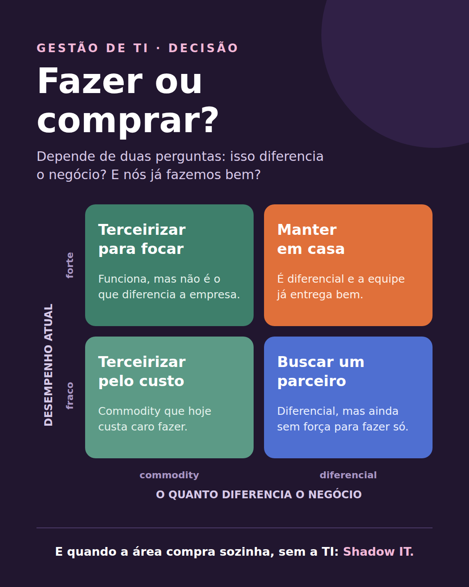

# Fazer ou comprar?

> Nota de origem: [Desafios do gestor de TI](../00-panorama/04-desafios-do-gestor-de-ti.md) · outubro/2026

---

## Texto do post

Assisti à live "Como lidar com os desafios atuais do Gestor de TI", do Gianni Ricciardi na TIexames, e uma das partes que mais gostei foi uma matriz simples para uma decisão difícil: fazer ou comprar.

Ela cruza duas perguntas:
• Isso diferencia o negócio ou é commodity?
• Nós já fazemos isso bem?

Daí saem quatro caminhos:
🟧 Diferencial e bem feito: manter em casa.
🟦 Diferencial, mas ainda fraco: buscar um parceiro.
🟩 Commodity bem feita: terceirizar para focar no que importa.
🟩 Commodity que custa caro: terceirizar pelo custo.

E o lado de risco: quando uma área assina um software sozinha, sem a TI saber, vira Shadow IT, com dados da empresa em lugares sem controle.

Outros pontos da aula: projeto e operação andam juntos (todo projeto vira operação), e normas como a ISO/IEC 38500 e a 38505-1 (governança de dados) ajudam a organizar quem decide o quê.

Na sua empresa, quem decide entre fazer ou comprar uma tecnologia?

#GestãoDeTI #GovernançaDeTI #ShadowIT #GRC

## Primeiro comentário

Deixei minhas anotações completas desta aula, com exemplos e perguntas de revisão, num repositório aberto no GitHub: https://github.com/alexpernaoficial/governanca-ti-estudos/blob/main/00-panorama/04-desafios-do-gestor-de-ti.md
