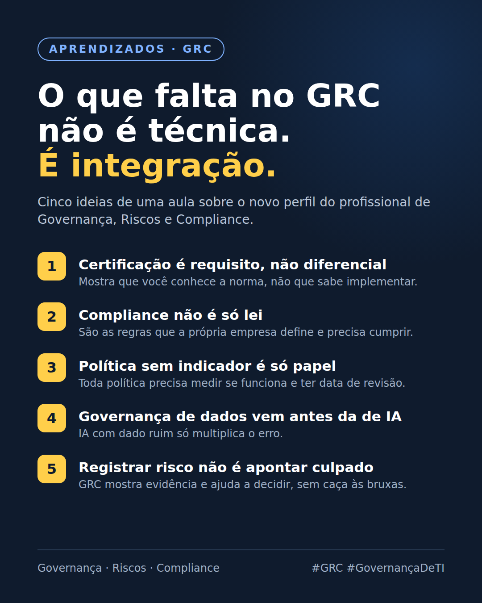

# O que falta no GRC não é técnica. É integração.

> Nota de origem: [O novo profissional de GRC](../00-panorama/02-o-novo-profissional-de-grc.md) · outubro/2026

---

Assisti à aula "O Novo Profissional de GRC que o Mercado Procura", do Wellington Mônaco na TIexames, e saí com algumas ideias que mudaram meu jeito de ver Governança, Riscos e Compliance.

Anotei cinco:

1️⃣ Certificação é requisito, não diferencial. Ela mostra que você conhece a norma. O que diferencia é saber aplicar no dia a dia da empresa.

2️⃣ Compliance não é só lei. Também são as regras que a própria empresa cria e precisa cumprir: políticas, contratos, procedimentos.

3️⃣ Política sem indicador é só papel. Toda política precisa de um jeito de medir se está funcionando e de uma data para ser revisada.

4️⃣ Governança de dados vem antes da governança de IA. Quando o dado é ruim, a IA só multiplica o erro.

5️⃣ Registrar risco não é apontar culpado. O papel do GRC é trazer evidência e ajudar a decidir, não caçar responsáveis.

O que mais ficou comigo foi a ideia de que, muitas vezes, o que falta não é conhecimento técnico. Falta integrar o que já existe.

Pra quem é da área: qual dessas você vê mais no dia a dia?

#GRC #GovernançaDeTI #Compliance #GestãoDeRiscos #Aprendizado
