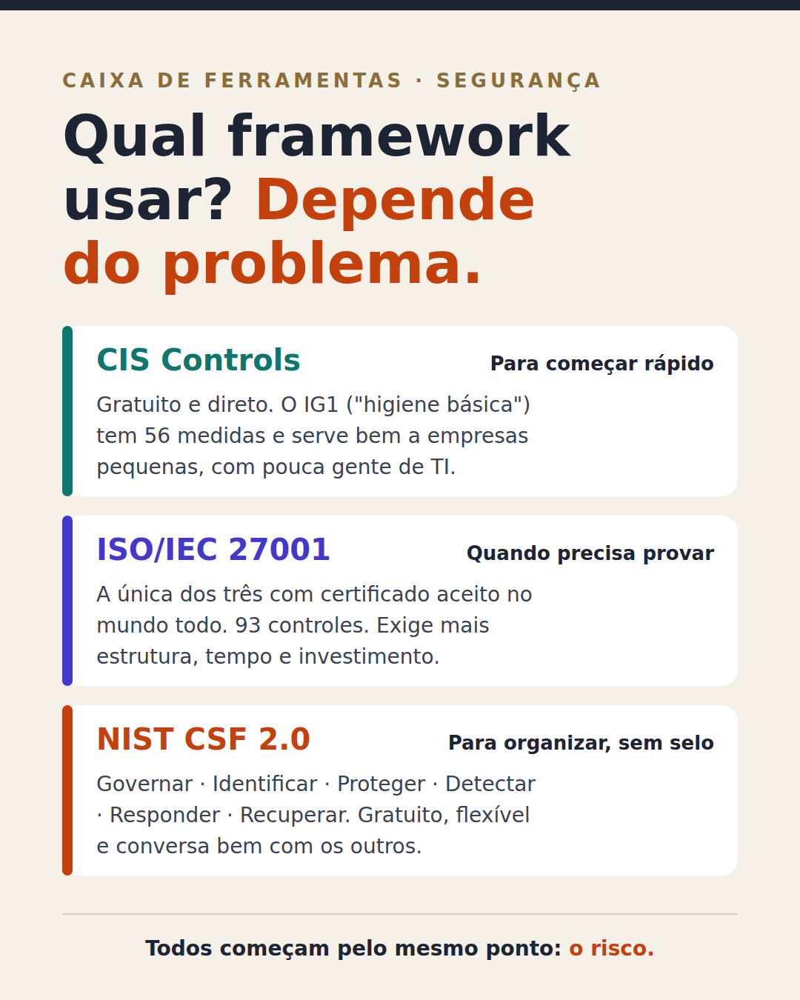

# Qual framework usar? Depende do problema.

> Nota de origem: [Comparando frameworks: NIST CSF, ISO/IEC 27001 e CIS Controls](../00-panorama/03-comparando-frameworks-nist-iso-cis.md) · outubro/2026

---

Assisti à aula "Comparando Frameworks NIST CSF, ISO/IEC 27001 e CIS Controls", do Rafael na TIexames, e gostei da forma como ele resumiu o tema: framework de segurança é uma caixa de ferramentas. Não adianta sair com o martelo batendo em tudo se o problema é um parafuso.

O que ficou para mim:

🧰 CIS Controls: gratuito e direto. O primeiro grupo ("higiene básica") tem 56 medidas e é um ótimo começo para empresas pequenas.

📜 ISO/IEC 27001: a opção quando é preciso provar com certificado, aceito no mundo todo. Pede mais estrutura, tempo e investimento.

🧭 NIST CSF 2.0: seis funções (Governar, Identificar, Proteger, Detectar, Responder e Recuperar), gratuito e flexível. Não tem certificado, mas conversa bem com os outros.

E um ponto que vale para todos: eles começam pelo risco. Ninguém coloca a camisa no cofre do hotel, coloca o que tem valor.

Outra ideia que gostei: dá para testar a resposta a incidentes sem esperar um incidente. Simula, mede o tempo e melhora.

Para quem já implementou algum deles: por qual vocês começaram?

#SegurançaDaInformação #ISO27001 #NIST #CISControls #GRC
