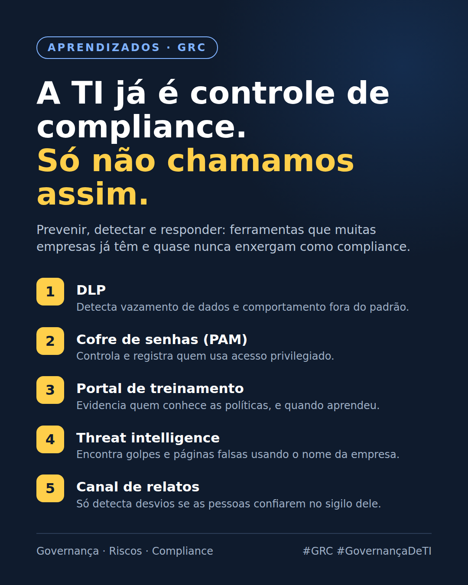

# A TI já é controle de compliance. Só não chamamos assim.

> Nota de origem: [Papel estratégico da TI em programas de GRC](../00-panorama/01-papel-estrategico-da-ti-em-grc.md) · outubro/2026

---

Assisti à aula "Papel Estratégico da TI em Programas de GRC", da Cristiane Sobral na TIexames, e uma ideia ficou na cabeça: muita coisa que a TI já faz é controle de compliance. Só não costuma ser vista assim.

Programas de compliance seguem uma lógica simples: prevenir, detectar e responder. E várias ferramentas comuns entram direto nisso:

🔹 DLP: detecta vazamento de dados e comportamento fora do padrão.
🔹 Cofre de senhas (PAM): controla e registra quem usa acesso privilegiado.
🔹 Portal de treinamento: mostra quem conhece as políticas, e quando aprendeu.
🔹 Threat intelligence: encontra golpes e páginas falsas usando o nome da empresa.
🔹 Canal de relatos: detecta desvios, mas só funciona se as pessoas confiarem no sigilo dele.

Outro ponto que gostei: antes de perguntar "quais controles eu preciso?", a pergunta certa é "quais são os meus riscos?". Controle sem risco por trás é custo sem motivo.

Fechou com uma frase do Cortella que resume bem a gestão de riscos: fazer biópsia, não autópsia.

Na sua empresa, a TI participa das discussões de compliance ou fica só na parte técnica?

#GRC #Compliance #GovernançaDeTI #SegurançaDaInformação #ISO27001
